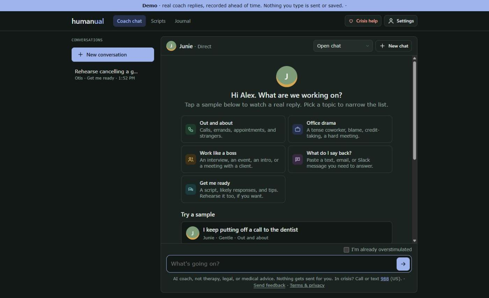
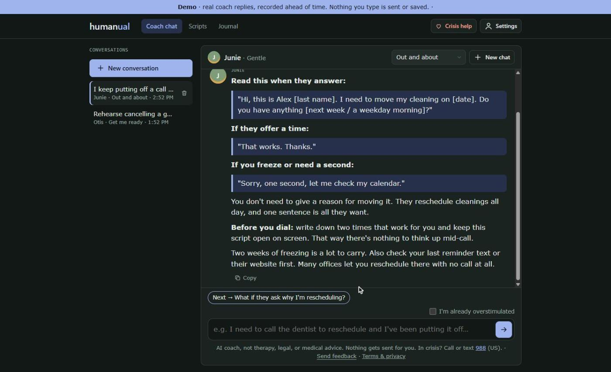
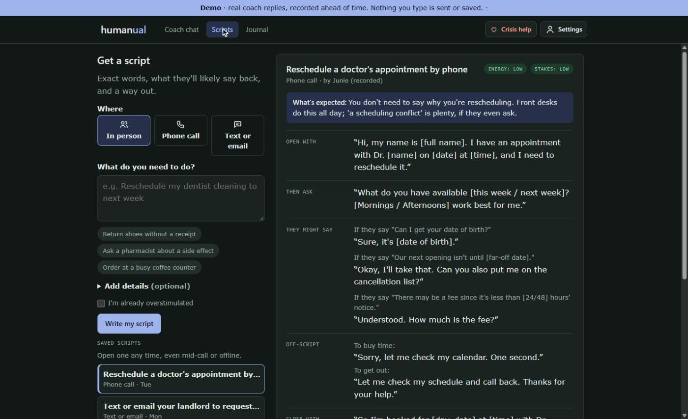
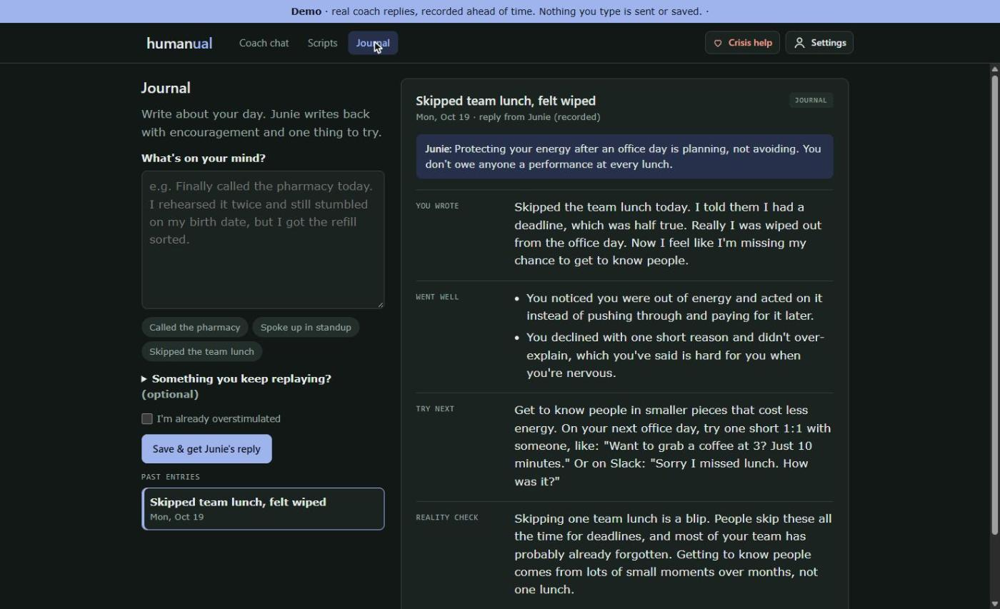
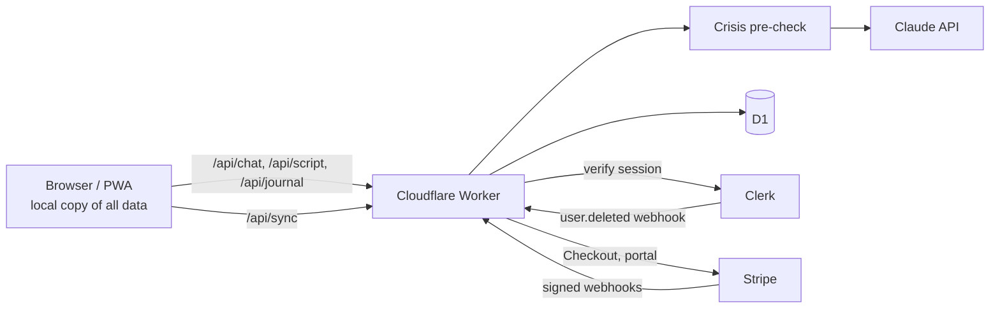

# Humanual

A web app that helps neurodivergent adults handle social situations without overloading: phone calls, appointments, tense coworkers, and messages they don't know how to answer.

- **Live app:** https://humanual.app
- **Public demo** (no sign-in, nothing saved): https://demo.humanual.app/demo

This repo shows how Humanual is built and tested. The application source, coaching prompts and coach personas stay in a private repo. The test files here are copied from it unchanged, so they import modules that aren't included.

## What it does

| | |
|---|---|
| **Coach chat** | Talk a situation through with a coach (Junie or Otis) in a Direct or Gentle style. Replies are short and concrete, with exact words to say. |
| **Scripts** | Describe a call, errand or message and get a script card: what to open with, what they'll probably say back, and a way out if it goes off script. |
| **Journal** | Write about the day and get encouragement, what went well, one thing to try next and a reality check. |
| **"I'm already overstimulated"** | A switch next to every text box that makes replies very short, one step at a time. |

## Stack

- **Cloudflare Workers** serve the API and the static UI from one Worker.
- **Cloudflare D1** (SQLite) stores synced profiles, conversations, scripts, journal entries, balances and usage.
- **Claude** (Anthropic API) does the coaching, with streaming replies, prompt caching and structured output for script and journal cards.
- **Clerk** handles sign-in. Guests can use the app without an account, and their data moves into the account if they sign up later.
- **Stripe** sells reply packs and a monthly plan through hosted Checkout, with a webhook for fulfilment.
- **Plain HTML, CSS and JavaScript** for the UI, with no build step. It works offline and installs as a PWA.
- **TypeScript**, **Node's built-in test runner** and **Playwright** for testing.

## Architecture

Some design decisions worth calling out:

- **Crisis messages are checked first.** Every chat message goes through a crisis pre-check before the model sees it. A crisis reply never costs the user anything, and crisis exchanges are never saved to the coach's memory.
- **Offline first.** Each device keeps a full copy of the user's data and syncs changes. The newest edit wins per item, deletes sync as markers, and edit times far in the future are pulled back so a device with a wrong clock can't win every conflict.
- **Payments are idempotent.** A purchase is credited exactly once, whether the Stripe webhook or the user's return from Checkout arrives first. For the subscription, Stripe is the source of truth, so late, repeated or out-of-order events can't leave the wrong status.
- **AI spend has limits.** Every AI call is tracked per person, and free usage has daily and monthly backstops so the bill can't run away.
- **Privacy.** The model provider only ever sees a hashed user ID. Users can view and delete anything the coach remembers, delete all their data, or delete their account, which erases everything kept about them except purchase records.

## Testing

Testing is the part I care most about (I run [Elite Test Automation](https://elitetestautomation.com)). Humanual has four layers:

| Layer | Runs with | What it covers |
|---|---|---|
| **Unit** | `node --test` | Sync against the real D1 schema in SQLite, the crisis pre-check, request handling. No server or API calls. |
| **Integration** | `node --test` + a fake Stripe server | Buying packs and the plan through the whole Worker, with Stripe replaced by a stateful fake HTTP server (service virtualization). |
| **Contract** | `stripe-mock` | Checks that every request the app sends to Stripe would be accepted by Stripe's own API description. |
| **End-to-end** | Playwright | Sign-in and sync between devices, the public demo, the mobile layout, and a small live run against the real model. |

### Included here

**[`tests/integration/fake-stripe.ts`](tests/integration/fake-stripe.ts)** is a stand-in for the Stripe API that runs as a real HTTP server. The Worker's real Stripe SDK, with its retries, headers and form encoding, talks to it over the wire. The fake keeps state between calls (customers, Checkout sessions, subscriptions), replays requests that repeat an idempotency key, and signs webhooks the way Stripe does. Tests can inject faults to make Stripe fail on purpose. Any call it doesn't recognize gets Stripe's own 404, so a new Stripe call shows up as a failing test instead of passing silently.

**[`tests/integration/payments.test.ts`](tests/integration/payments.test.ts)** has 15 scenarios, including:

- A guest buys a pack, and the webhook credits it exactly once
- The user comes back from Checkout before the webhook arrives
- A guest buys and then signs in, with the webhook arriving after the sign-in
- Webhook events arrive late or out of order
- A failed card keeps the plan active while Stripe retries it
- A Stripe 500 is retried with the same idempotency key, invisibly to the user
- Stripe is down, and the user gets a plain message instead of a crash
- Only webhooks signed with the right secret, and recent, change anything

**[`tests/integration/stripe-contract.test.ts`](tests/integration/stripe-contract.test.ts)** runs the app's real Stripe calls against `stripe-mock`. It first checks that the mock rejects bad requests, so the passing checks actually mean something.

**[`tests/e2e-demo.mjs`](tests/e2e-demo.mjs)** is a Playwright test for the public demo. It fails if the demo calls the API (which would spend money), stores anything in the browser, or drifts from its recorded replies.

**[`tests/e2e-mobile.mjs`](tests/e2e-mobile.mjs)** is a Playwright test for phones: the layout fits the screen, the keyboard never pops up on its own, text boxes are big enough that iPhones don't zoom, and the installable-app parts (manifest, home screen shortcuts, offline notice) work.

## About

Built by Heather at [Elite Test Automation](https://elitetestautomation.com). Humanual is a commercial product. This repo is for showing the work, and the code in it isn't licensed for reuse.
